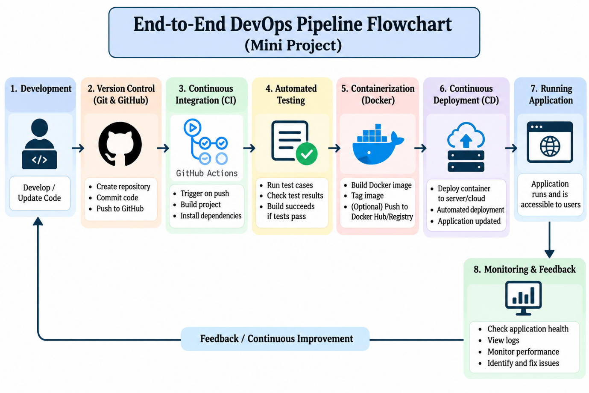

# DevOps pipeline for Sprintboard

This project implements the end-to-end pipeline from the mini-project flowchart.

**Flow:** Development → Git/GitHub → CI → Testing → Docker → CD → Running application → Monitoring & feedback → Continuous improvement

## Where each stage lives in the repo

| # | Stage | What happens | Files |
|---|-------|--------------|-------|
| 1 | Development | Edit the app, run it locally, run tests | `index.html`, `css/`, `js/app.js`, `package.json` (`npm start`, `npm test`) |
| 2 | Version control (Git & GitHub) | Commit and push to GitHub; PRs use a checklist | `.gitignore`, `.github/pull_request_template.md` |
| 3 | Continuous integration | GitHub Actions starts on every push / PR, installs dependencies, lints | `.github/workflows/ci-cd.yml` (job `build-and-test`) |
| 4 | Automated testing | 9 tests drive the real UI in jsdom; a failing test stops the pipeline | `tests/app.test.js` |
| 5 | Containerization (Docker) | Builds an nginx image, tags it (`sha-xxxxxxx`, `latest`), pushes to GitHub Container Registry | `Dockerfile`, `nginx/default.conf`, `.dockerignore`, job `docker` |
| 6 | Continuous deployment | Pulls the new image on your server over SSH and restarts the container | job `deploy` |
| 7 | Running application | Smoke test calls `/health` after deploy; app is served on port 80 | job `deploy` (step "Smoke test"), `scripts/healthcheck.sh` |
| 8 | Monitoring & feedback | Health endpoint, Docker HEALTHCHECK, request logs, build info, feedback issue template | `nginx/default.conf`, `Dockerfile`, `.github/ISSUE_TEMPLATE/feedback.md` |

Feedback from stage 8 becomes new user stories in the Sprintboard backlog, which feeds stage 1 again.

## 1. Run it locally

    npm install        # once
    npm test           # stage 4 on your machine
    npm start          # http://localhost:8000 (no Docker)

With Docker:

    docker compose up -d --build        # http://localhost:8080
    scripts/healthcheck.sh              # checks /health, the home page, /version.json
    docker logs -f sprintboard          # live request logs
    docker ps                           # STATUS shows (healthy) or (unhealthy)

## 2. Put it on GitHub

    git init
    git add .
    git commit -m "Initial commit"
    git branch -M main
    git remote add origin https://github.com/<you>/sprintboard.git
    git push -u origin main

The first push triggers the pipeline. Open the **Actions** tab to watch the three jobs run.

## 3. What happens on each push

1. **build-and-test** installs dependencies with `npm ci`, runs `npm run lint` and `npm test`.
2. **docker** (only if step 1 passed) builds the image. On pull requests it only builds; on `main` it also pushes to `ghcr.io/<you>/sprintboard` with the tags `sha-<commit>` and `latest`.
3. **deploy** (only on `main`) connects to your server, pulls `latest`, restarts the container, then calls `/health` up to 6 times.

If any stage fails, later stages do not run. That is the point of the pipeline.

## 4. Turn on deployment (optional)

Without these secrets the deploy job prints a notice and skips, so the pipeline stays green. To deploy to a real server (any Linux VM with Docker installed, e.g. an AWS EC2, Azure, or DigitalOcean machine):

Repository → Settings → Secrets and variables → Actions → New repository secret:

| Secret | Value |
|--------|-------|
| `DEPLOY_HOST` | Server IP or hostname |
| `DEPLOY_USER` | SSH user, e.g. `ubuntu` |
| `DEPLOY_SSH_KEY` | Private key whose public half is in the server's `~/.ssh/authorized_keys` |
| `GHCR_PULL_TOKEN` | Only if the package is private: a personal access token with `read:packages` |

Also open port 80 in the server's firewall / security group. The job uses a GitHub *environment* named `production`, which you can protect with required reviewers if you want a manual approval before deploying.

To use Docker Hub instead of GHCR, change the `login-action` registry and credentials and the `images:` value in the `docker` job.

## 5. Monitoring & feedback

- `GET /health` returns `ok` (used by Docker, the CD smoke test, and any uptime monitor such as UptimeRobot).
- `GET /version.json` shows the commit and build time of the running container. The same commit is shown in the app footer.
- `docker logs sprintboard` shows nginx access and error logs.
- `docker inspect --format '{{.State.Health.Status}}' sprintboard` shows container health.
- Problems found by users go in a GitHub issue using the **Feedback or bug** template; turn them into user stories in the backlog and the cycle starts again.

## Honest limits of this mini project

- Everything runs on the free GitHub-hosted runner; nothing was run against a real server while building this, so test the deploy job once with your own VM.
- App data lives in each visitor's browser (localStorage), so there is no database to back up or monitor. A Flask + database version would add stages worth testing and monitoring.
